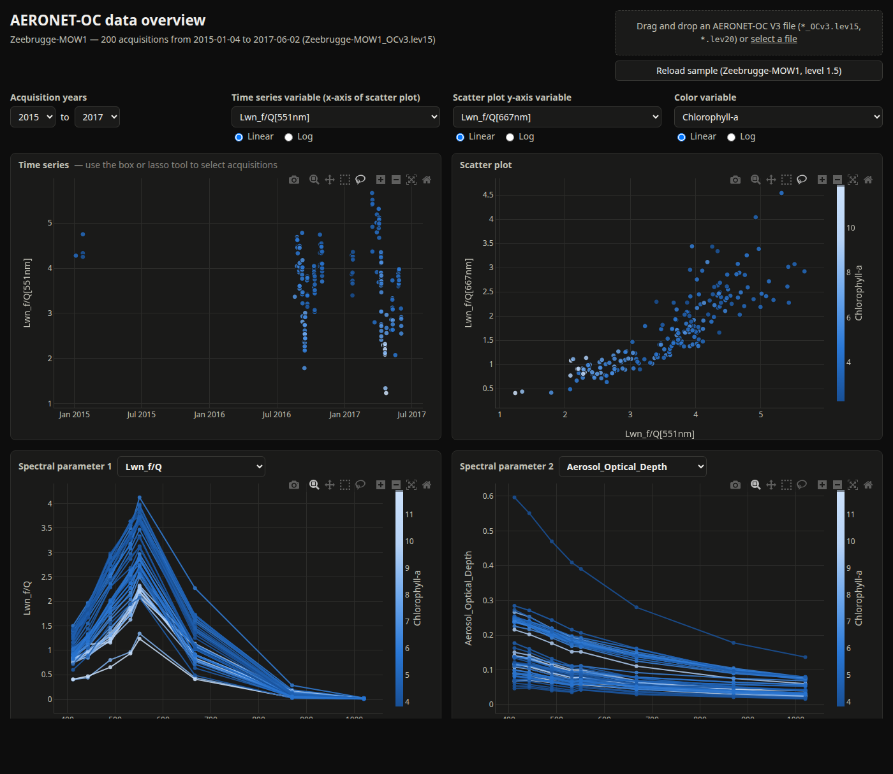

# aeronet_visu

Visualization tool for [AERONET](https://aeronet.gsfc.nasa.gov/) / AERONET-OC data.

`aeronet_visu` provides:

* readers converting AERONET (AOD, SDA, inversions) and AERONET-OC (Ocean Color) files into
  multi-indexed `pandas.DataFrame` objects,
* an interactive [Dash](https://dash.plotly.com/) dashboard to explore AERONET-OC Version 3 data:
  time series, scatter plots and spectra of the water-leaving radiances and aerosol optical depths.



*AERONET-OC dashboard for the Zeebrugge-MOW1 site (level 1.5): time series and scatter plot of the
normalized water-leaving radiances colored by chlorophyll-a, and spectra of the selected acquisitions.*

## Data

AERONET-OC data can be downloaded from the NASA AERONET website:
<https://aeronet.gsfc.nasa.gov/new_web/draw_map_display_seaprism_v3.html?level=2>

Select a site on the map and download its Version 3 data file (e.g., `<site>_OCv3.lev15` or
`<site>_OCv3.lev20` for level 1.5 and level 2.0 data, respectively).

Note: AERONET-OC data are distributed by the International AERONET Federation. As stated in the
header of the data files, their use requires offering co-authorship to the Principal Investigator (PI)
of the site.

## Installation

Requires Python 3. Install directly from GitHub:

```bash
pip install git+https://github.com/Tristanovsk/aeronet_visu.git
```

or from a local clone (use `-e` for an editable, development install):

```bash
git clone https://github.com/Tristanovsk/aeronet_visu.git
cd aeronet_visu
pip install -e .
```

## Usage

### Dashboard

Launch the dashboard from a terminal:

```bash
aeronet_visu
```

or from Python:

```python
from aeronet_visu.visu_main import WrappedDash

WrappedDash(debug=True)
```

then open <http://127.0.0.1:8050> in a web browser and upload an AERONET-OC file.

### Data loading

```python
from aeronet_visu import data_loading as dl

df = dl.Read('Zeebrugge-MOW1_OCv3.lev15').read_aeronet_ocv3()
df = df.droplevel([1, 2], axis=1)  # flat column names, e.g. 'Lwn_f/Q[551nm]'

# normalized water-leaving radiance spectra (bidirectional correction f/Q)
lwn = df.filter(regex=r'^Lwn_f/Q\[')
```

## License

MIT License, see [LICENSE](https://github.com/Tristanovsk/aeronet_visu/blob/master/LICENSE).
